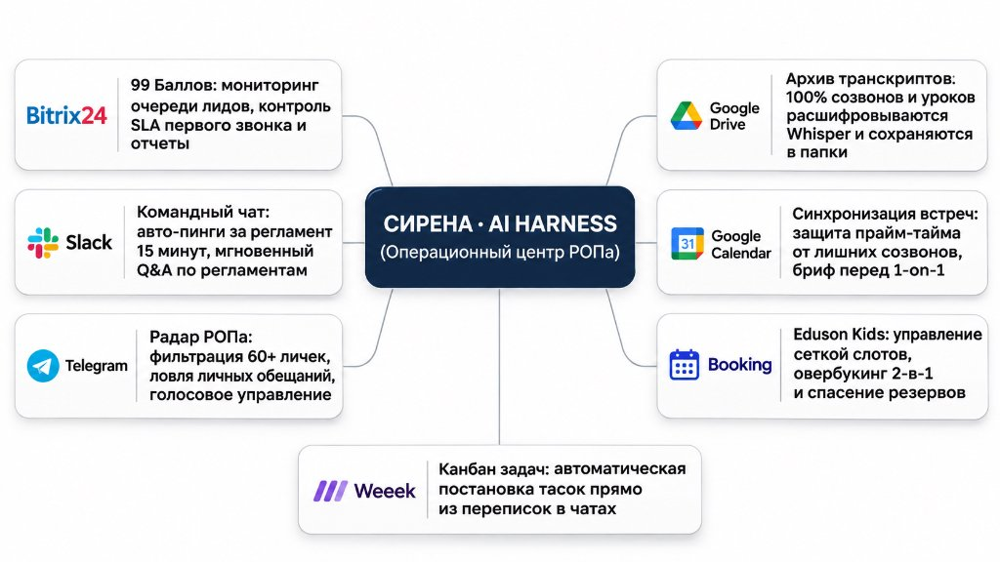
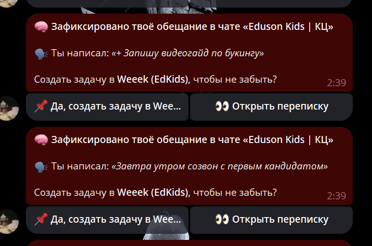
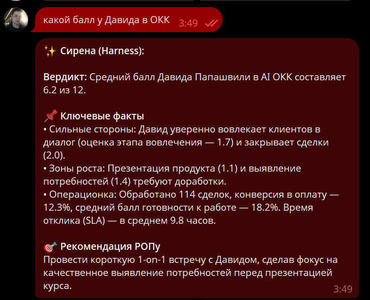

# 🚀 Sales Harness — Персональный AI-экзоскелет для РОПа и CCO

> Автономный операционный ассистент, который связывает таблицы, календари, CRM и мессенджеры в единый контур управления. Забирает 80% рутины по контролю регламентов, отслеживает дедлайны отчетов и держит фокус руководителя на выручке.



---

## 🍏 Быстрый старт на macOS (M1/M2/M3/M4 и Intel)

На последней версии macOS (Sequoia / Sonoma) всё разворачивается одной командой:

1. Открой программу **Терминал** (Terminal) через Spotlight (нажми `Cmd + Пробел` ➔ введи `Terminal` ➔ Enter).
2. Склонируй репозиторий и запусти мастер настройки:
```bash
git clone https://github.com/eduson-ops/sales-harness.git
cd sales-harness
bash install-mac.sh
```
Скрипт сам проверит Node.js (если его нет — установит через Homebrew), скачает зависимости и запустит интерактивный мастер настройки `setup.mjs`.

### 🛡 Фоновый запуск на Mac (чтобы работал при закрытой крышке):
```bash
npx pm2 start src/cli.mjs --name sales-harness
npx pm2 startup   # автоматический старт при перезагрузке ноутбука
npx pm2 save
```

---

## ⚡ Быстрый старт на Windows / Linux

```bash
git clone https://github.com/eduson-ops/sales-harness.git
cd sales-harness
npm install
npm run setup
```

Мастер прямо в терминале простым языком спросит нужные ссылки и токены (Telegram, Google Таблицы, Календари, Weeek / Notion). Все подсказки, где взять ключи за 1 минуту, выводятся прямо на экран.

### Проверка подключений и запуск:
```bash
npm run test-connectors   # Проверка статуса всех интеграций
npm run briefing          # Моментальный тест утренней сводки
npm start                 # Запуск фонового надзора (tick 30s)
```

---

## 📸 Как это выглядит в боевом режиме

| Ловля обещаний РОПа ➔ Weeek | Аудит звонков сейлов (AI ОКК) |
| :---: | :---: |
|  |  |
| *Сканирует переписки от твоего лица, ловит обещания и предлагает создать таску в Weeek за 1 клик* | *Мгновенный скоринг менеджера в Telegram-боте по 12 критериям без захода в CRM* |

---

## 🧩 Архитектурные узлы системы

1. **Telegram Userbot (чтение от своего лица)**:
   - Мониторит 60+ рабочих чатов и личек.
   - Вылавливает твои обещания («скину гайд», «созвонюсь завтра») и превращает их в задачи Weeek / Notion.
   - Защищает от потери контекста при перегрузке.

2. **Telegram Bot (личный командный пульт)**:
   - Утренний бриф (09:30): кто на смене, план/факт выручки, критические висяки.
   - Запросы на лету («какой балл у Давида в ОКК», «сколько свободных слотов на вечер»).

3. **Bitrix24 / AmoCRM**:
   - Контроль очереди лидов и соблюдения SLA первого звонка (до 10 минут).
   - Алерты о перелидозе или зависших сделках без следующего шага.

4. **Slack (командный чат отдела)**:
   - Авто-пинги менеджерам за нарушение регламента (15 минут на сдачу отчета по встрече/уроку).
   - Мгновенный Q&A по регламентам отдела для новичков.

5. **Календари (Google / Яндекс)**:
   - Защита прайм-тайма руководителя от случайных встреч.
   - Автоматический бриф по сотруднику перед встречей 1-on-1.

6. **Google Drive & Whisper**:
   - 100% созвонов и уроков расшифровываются нейросетью и складываются в архив базы знаний.

---

## 📚 Документация по настройке

- [Каталог бизнес-сценариев и правил пингов](docs/SCENARIOS_CATALOG.md)
- [Подключение Telegram Userbot (чтение чатов от своего лица)](docs/TELEGRAM_USERBOT_SETUP.md)
- [Подключение AmoCRM за 3 шага](docs/AMOCRM_SETUP.md)

---

## 🔒 Безопасность данных

- **Никаких облачных посредников**: код крутится локально на твоем Mac или сервере.
- **Секреты защищены**: файл `.env` исключен из репозитория через `.gitignore`.
- **Безлимитный бесплатный AI-мозг**: интеграция с Google Gemini API через персональный ключ.
