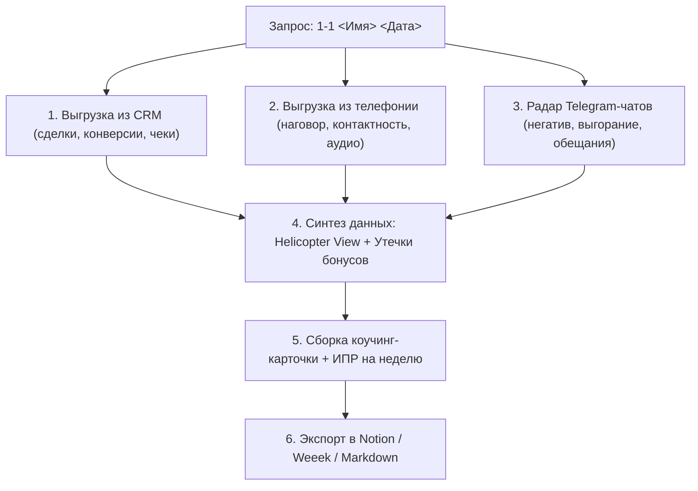

# 🎯 1-on-1 Coaching & Growth Skill (Sales Management)

Этот скилл создает практическую коучинг-карточку регулярной 1-on-1 встречи руководителя отдела продаж (РОПа) с менеджером.
Карточка создается **не для галочки**, а как интерактивный рабочий инструмент: РОП показывает её на экране во время созвона, а после встречи отправляет сейлу как его персональный спринт-трекер и ИПР на неделю.

---

## 🎯 Триггеры вызова
- `"1-1 Иван Иванов 12.11"`
- `1-1 <Имя Сейла> <ДД.ММ>`
- `"сделай ив с <имя> на сегодня"`
- `"проведи 1-on-1 с <имя>"`

---

## 🏗️ Архитектура анализа данных



---

## ⚡ Источники данных и настройка под компанию

Все параметры настраиваются через переменные окружения (`.env`):
- `CRM_TYPE` — `amocrm` или `bitrix24`.
- `CRM_WEBHOOK_URL` / `AMOCRM_ACCESS_TOKEN` — доступ к сделкам и статистике.
- `TELEPHONY_API_URL` — доступ к статистике звонков и записям (UIS / Voximplant / Zadarma).
- `TELEGRAM_USERBOT_ENABLED` — включение радара переписок (`true`/`false`).
- `NOTION_DATABASE_ID` / `WEEEK_PROJECT_ID` — место публикации карточек.

---

## 🔍 Ключевой блок: Радар Telegram-чатов сейла

Ассистент сканирует рабочие чаты и личные переписки сейла с клиентами за прошедшую неделю и выявляет:

1. **Маркеры выгорания и скрытого негатива**:
   - Жалобы на лиды в общих чатах («лиды нецелевые», «клиенты не берут трубки», «у людей нет денег»).
   - Пассивная агрессия в ответах коллегам или руководству.
   - Увеличение среднего времени ответа клиенту в личках (SLA первого ответа вырос с 5 мин до 40+ мин).
2. **Забытые обещания клиентам и РОПу**:
   - Зафиксированные фразы: «скину КП через час», «перезвоню сегодня до 18:00», «уточню по скидке».
   - Сопоставление с CRM: выполнено ли действие или лид остался брошенным.
3. **Нарушения стандартов общения**:
   - Переход на токсичный тон при возражениях клиентов.
   - Обещание несогласованных скидок или условий в личной переписке.

---

## 📋 Структура коучинг-карточки 1-on-1

Карточка встречи обязательно содержит 7 смысловых блоков:

### 1. 💡 Фокус встречи & Памятка для сейла
- Контекст недели, ключевая победа (выручка WON), главный вызов.
- Интерактивный статус спринта: эта карточка — рабочий экран на текущую неделю.

### 2. 📊 1. Обзор недели (План / Факт)
Таблица метрик за неделю:
- Выручка WON и средний чек.
- Конверсия из первого контакта в квалификацию и оплату.
- Всего звонков / результативных дозвонов (контактность в %).
- Суммарный наговор (минут в день) и средняя длительность звонка.
- Количество зависших сделок без даты следующего контакта.

### 3. 💬 2. Радар чатов: эмоциональный фон и обещания
- **Эмоциональный барометр**: оценка уровня энергии и вовлеченности (высокий / норма / риск выгорания).
- **Выявленный негатив / сопротивление**: цитаты или паттерны жалоб, требующие обсуждения на встрече.
- **Забытые обещания в чатах**: список лидов, где менеджер пообещал вернуться, но не написал.
- **SLA ответов в переписках**: среднее время реакции на входящие сообщения клиентов.

### 4. 🎧 3. Разбор диалогов недели (с прямыми ссылками на аудио/транскрипты)
- **Кейс #1: Эталонное закрытие (Best Practice)**
  - Разбор сильных приемов, правильного выявления болей и дожима.
- **Кейс #2: Зависший длинный диалог (>10-15 мин)**
  - Точка потери инициативы: где менеджер ушел в презентацию цен вместо донесения ценности.
  - Конкретный речевой модуль для реанимации клиента сегодня.
- **Кейс #3: Горячий лид на сегодня**
  - Сделка на согласовании с ЛПР — план дожима до конца дня.

### 5. 🚁 4. Helicopter View: Зеркало сейла
- 💎 **Суперсилы** (за счет каких качеств сейл делает максимальную кассу).
- ⚠️ **Финансовые утечки** (где менеджер теряет личные бонусы: слив этапа ЛПР, слабый наговор в первой половине дня, брошенные лиды в переписках).

### 6. 🎯 5. Индивидуальный план развития (ИПР) на неделю
3 жестких фокусных правила (не больше трех, чтобы не размывать фокус):
1. **Тайм-менеджмент**: жесткие слоты для набора звонков (например, 10:00-12:00 и 15:00-17:00).
2. **Техника продаж**: фиксация обязательного следующего шага (CTA) в каждом диалоге.
3. **Регламент мессенджеров**: ответ на входящие лиды в Telegram в течение 10 минут.

### 7. 📋 6. Спринт-трекер лидов прямо сейчас (Action Board)
Чек-лист горячих сделок сейла с ID в CRM, суммами и дедлайнами закрытия на сегодня-завтра.

---

## 🚀 Пример запуска команды в чате

```text
1-1 Алексей Смирнов 15.11
```

Ассистент:
1. Выгрузит показатели Алексея из CRM за текущий месяц.
2. Проанализирует статистику звонков и выделит 2 ключевых аудиозаписи.
3. Просканирует переписки в Telegram на предмет неотвеченных сообщений и скрытого негатива.
4. Соберет готовую карточку и создаст страницу в Notion/Weeek с тегом `#1on1`.
